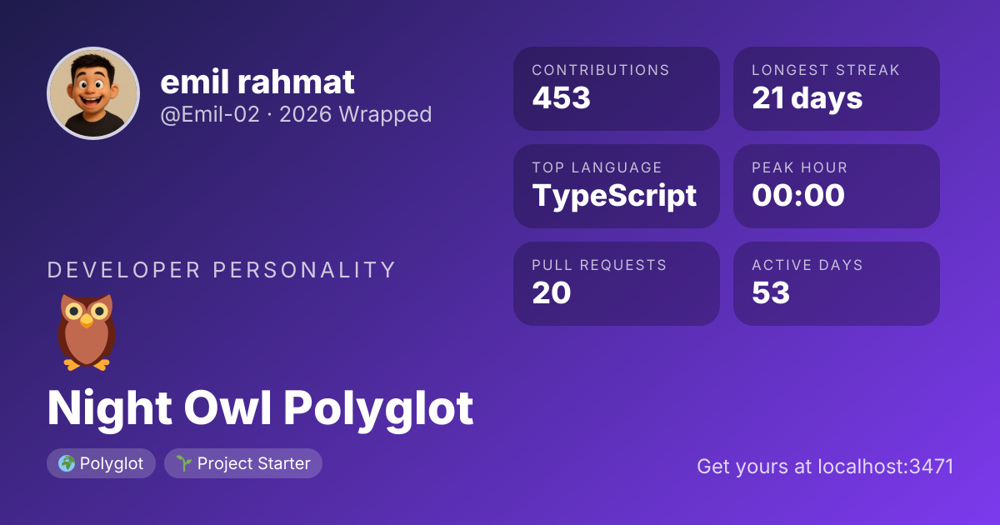

<div align="center">

# 🎁 git-wrapped

**Spotify Wrapped, but for your GitHub.**

Your contributions, streaks, languages, coding hours, and the developer personality you didn't know you had. All of it as Stories-style slides you can share.

[**Get your wrapped →**](https://github.com/Emil-02/git-wrapped) · [Add a personality](#-add-your-own-personality) · [Self-host](#-self-hosting)



</div>

## ✨ Features

- **Stories-style slides** with animations: tap, swipe, or use arrow keys. Space pauses.
- **Year in numbers**: total contributions, longest streak, busiest day, and a heatmap of the year.
- **Coding rhythm**: your peak coding hour, shown in *your* timezone.
- **Top languages and repos**, weighted by how much you actually committed.
- **Developer personality**: a rule-based archetype like *🦉 Night Owl Rustacean* or *⚔️ Weekend Warrior Gopher*, plus badges.
- **Share card**: a generated 1200×630 PNG. Download it, post it to X or LinkedIn, or use native mobile share.
- **Rich link previews**: every `/u/<username>` link unfurls with a personalised image.
- **Private mode (optional)**: sign in with GitHub to include private contributions. Private repo names are never shown on the card.
- **Privacy-friendly**: no database and no tracking. OAuth tokens live only in an encrypted, httpOnly cookie.

## 🧠 How the personality works

There's no AI and no magic, just [readable rules](src/lib/personality/rules.ts):

| Vibe | Rule (simplified) |
| --- | --- |
| 🦉 Night Owl | ≥ 40% of commits between 22:00 and 05:00 |
| 🐦 Early Bird | ≥ 35% of commits between 05:00 and 10:00 |
| ⚔️ Weekend Warrior | ≥ 35% of contributions on weekends |
| 🛡️ Code Guardian | More reviews than commits |
| 🔥 Unstoppable | A streak of 60+ days |
| ⚡ Burst Mode | Few active days, but huge spikes |
| 💼 Nine-to-Five | Peak hour during office hours, quiet weekends |
| 🌱 Steady | Everyone else, and that's great too |

The vibe is combined with your top language (`Rust → Rustacean`, `Go → Gopher`, `Python → Pythonista`, …) and up to three badges.

## 🧩 Add your own personality

This is the easiest way to contribute, and a good first PR:

1. Add a vibe, badge, or language nickname in [`src/lib/personality/rules.ts`](src/lib/personality/rules.ts).
2. Add a test in [`src/lib/personality/personality.test.ts`](src/lib/personality/personality.test.ts).
3. Run `npm test` and open a PR.

See [CONTRIBUTING.md](CONTRIBUTING.md) for details.

## 🚀 Self-hosting

[](https://vercel.com/new/clone?repository-url=https%3A%2F%2Fgithub.com%2FEmil-02%2Fgit-wrapped&env=GITHUB_TOKEN&envDescription=A%20GitHub%20token%20with%20no%20scopes%20to%20read%20public%20data)

1. Create a GitHub token with **no scopes** at <https://github.com/settings/tokens>.
2. Deploy, setting `GITHUB_TOKEN`.
3. *(Optional)* To enable "Sign in with GitHub", create an [OAuth App](https://github.com/settings/developers) with the callback URL `https://<your-domain>/api/auth/callback`, then set `GITHUB_CLIENT_ID`, `GITHUB_CLIENT_SECRET` and `AUTH_SECRET` (`openssl rand -hex 32`).

All options are listed in [`.env.example`](.env.example). Set environment variables **before building**, because the landing page is prerendered and only shows the sign-in link when OAuth is configured.

### Local development

```bash
git clone https://github.com/Emil-02/git-wrapped.git
cd git-wrapped
npm install
cp .env.example .env.local   # then fill in GITHUB_TOKEN
npm run dev
```

Open <http://localhost:3000/u/your-username>.

| Script | What it does |
| --- | --- |
| `npm run dev` | Start the dev server |
| `npm test` | Run unit tests (Vitest) |
| `npm run lint` | Lint with ESLint |
| `npm run typecheck` | Type-check with TypeScript |
| `npm run build` | Production build |

## 🏗️ How it works

```
src/
├── app/
│   ├── page.tsx                 # Landing page
│   ├── u/[username]/page.tsx    # Public wrapped (cached)
│   ├── me/page.tsx              # Private wrapped (signed in)
│   └── api/
│       ├── og/[username]/       # Share image (next/og)
│       └── auth/                # GitHub OAuth (login/callback/logout)
├── components/wrapped/          # Slides, player and summary card
└── lib/
    ├── github/                  # GraphQL queries and fetching
    ├── stats/                   # Pure stats functions (tested)
    ├── personality/             # Personality rules (tested)
    └── auth/                    # Encrypted session cookie
```

- Data comes from the GitHub GraphQL API, using two cheap queries per user. Results are cached for hours with `"use cache: remote"`, so viral traffic doesn't burn through rate limits.
- Commit hours come from your authored commits on the default branch of your top 10 repositories (up to 100 per repo). Hours are computed in the viewer's browser timezone. Shared links carry `?tz=` so everyone sees the same result.
- During January, the wrapped shows the previous full year.

**Stack:** [Next.js](https://nextjs.org) (App Router, Cache Components) · TypeScript · Tailwind CSS · [Motion](https://motion.dev) · Vitest.

## 🔒 Privacy

- Public mode only reads data that is already public on GitHub.
- In private mode, your token is stored only in an AES-GCM encrypted, httpOnly cookie that expires after 24 hours. It is never written to a database or log. Private wrapped data is never cached on the server.
- Private repository names are replaced with "Private repository" everywhere they could be shared.

## 📄 License

[MIT](LICENSE). Not affiliated with GitHub or Spotify.

If git-wrapped made you smile, a ⭐ helps others find it.
